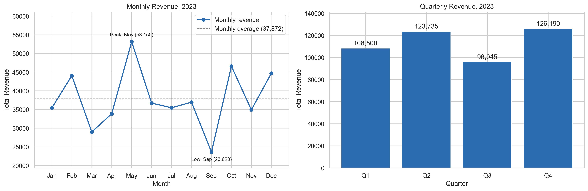
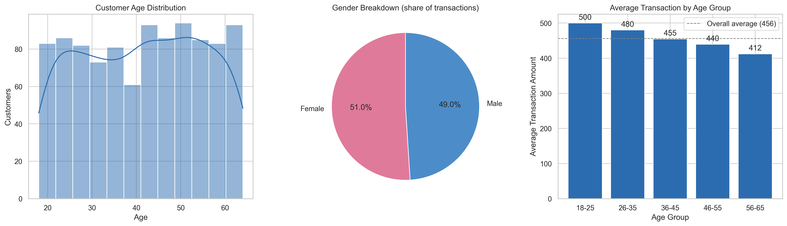
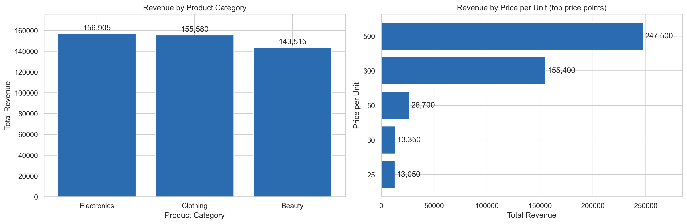
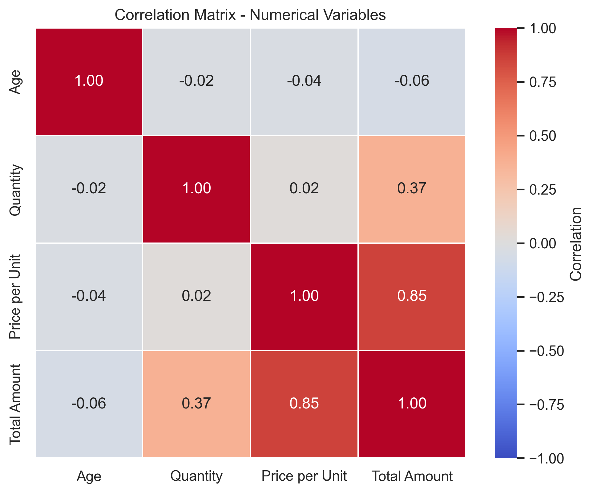
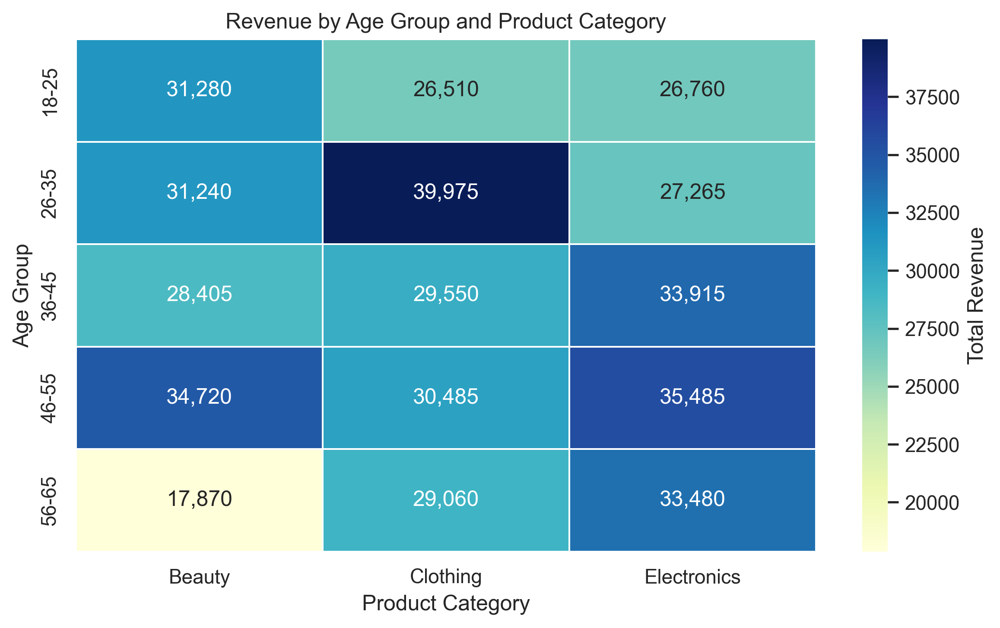

# Exploratory Data Analysis on Retail Sales Data

**Oasis Infobyte Internship (SIP) · Data Analytics · Level 1 · Task 1**

An exploratory data analysis (EDA) of a retail sales dataset, covering sales trends over time, customer demographics, product performance and correlations, and ending with actionable business recommendations.

## Objective

Explore 1,000 retail transactions to uncover patterns in sales and customer behaviour, then turn those findings into specific recommendations a business could act on.

## Dataset

- **File:** `retail_sales_dataset.csv` (Retail Sales Dataset, sourced from Kaggle)
- **Size:** 1,000 transactions, 9 columns
- **Period:** 1 Jan 2023 to 1 Jan 2024

| Column | Description |
|---|---|
| Transaction ID | Unique ID of each transaction |
| Date | Date of the transaction |
| Customer ID | Customer identifier |
| Gender | Male / Female |
| Age | Customer age (18-64) |
| Product Category | Clothing, Electronics or Beauty |
| Quantity | Units purchased |
| Price per Unit | Price of one unit |
| Total Amount | Quantity x Price per Unit |

## Tech stack

Python 3, pandas, NumPy, Matplotlib, Seaborn, Jupyter Notebook

## What the notebook covers

1. **Data inspection and quality checks:** shape, data types, missing values, duplicate IDs, invalid dates/ages/quantities/prices, and a check that `Total Amount = Quantity x Price per Unit`.
2. **Descriptive statistics:** mean, median, mode and standard deviation for every numerical column.
3. **Overall sales performance:** total revenue, transactions, average transaction and items sold, broken down by category, gender and age group.
4. **Time series analysis:** monthly and quarterly revenue trends (line and bar charts).
5. **Customer demographics:** age distribution, gender breakdown and average spend by age group.
6. **Product analysis:** revenue by product category and by price point.
7. **Correlation heatmap** between the numerical variables.
8. **Additional insight:** a heatmap of revenue by age group x product category.
9. **Conclusions:** three or more business recommendations (four are given) and the limitations of the analysis.

Every chart is followed by a markdown cell with written observations.

## Key findings

- **Headline numbers:** 456,000 total revenue from 1,000 transactions (average transaction 456, 2,514 items sold).
- **Data quality:** the dataset is clean. There are no missing values, duplicates or inconsistent totals.
- **Categories are evenly balanced:** Electronics 156,905 (34.4%), Clothing 155,580 (34.1%), Beauty 143,515 (31.5%). Clothing leads on transactions and items sold, Electronics leads on value per sale, and Beauty is last on all three measures.
- **Sales are seasonal:** revenue peaks in May (53,150) and is strong again in October and December, with a clear low in September (23,620). By quarter, Q4 (126,190) and Q2 (123,735) are strongest and Q3 (96,045) is weakest.
- **Gender is not a differentiator:** average transaction is about 456 for both female and male customers.
- **Age is:** the 18-25 group spends the most per transaction (about 500) and spend falls steadily with age to about 412 for ages 56-65. The 46-55 group is the largest by revenue (100,690) and transactions (229).

## Business recommendations

1. **Plan around seasonality:** stock up and staff ahead of the May and Q4 peaks, and run promotions or loyalty offers in September.
2. **Segment marketing by age, not gender:** premium offers for younger customers, frequency and loyalty offers for the 46-55 group.
3. **Grow Beauty through cross-selling and bundling** with Clothing and Electronics.
4. **Target category promotions by age group** using the age x category heatmap.

## Limitations

- Only one year of data, and January 2024 contains just 2 transactions (1 Jan 2024), so it is excluded from the time-series charts. Seasonal patterns are indicative rather than proven.
- The dataset has no product-name column, so the product analysis is done by product category and price point.
- Each `Customer ID` appears to have a single transaction, so repeat-purchase behaviour and customer lifetime value cannot be analysed.

## Visualisations

Running the notebook saves these charts to the `figures/` folder:

| Chart | File |
|---|---|
| Monthly and quarterly revenue | `figures/time_series.png` |
| Age distribution, gender split, spend by age group | `figures/demographics.png` |
| Revenue by category and price point | `figures/product_analysis.png` |
| Correlation heatmap | `figures/correlation_heatmap.png` |
| Revenue by age group and category | `figures/age_category_heatmap.png` |







## How to run

1. Clone the repository and open this folder:
   ```bash
   git clone https://github.com/<aya-mansourr>/OIBSIP.git
   cd OIBSIP/DataAnalytics-L1-EDARetailSales
   ```
2. Install the dependencies:
   ```bash
   pip install pandas numpy matplotlib seaborn jupyter
   ```
3. Make sure `retail_sales_dataset.csv` is in the same folder as the notebook.
4. Open `retail_sales_eda.ipynb` in Jupyter or VS Code and choose **Run All**.

## Project structure

```
DataAnalytics-L1-EDARetailSales/
├── retail_sales_eda.ipynb      # the full analysis
├── retail_sales_dataset.csv    # dataset
├── figures/                    # charts saved by the notebook
└── README.md
```

## Author

**Aya Mansour** · Data Analytics Intern, Oasis Infobyte
[LinkedIn](https://www.linkedin.com/in/ayaa-mansour) · [GitHub](https://github.com/aya-mansourr)

#oasisinfobyte #dataanalytics #python #eda #internship
